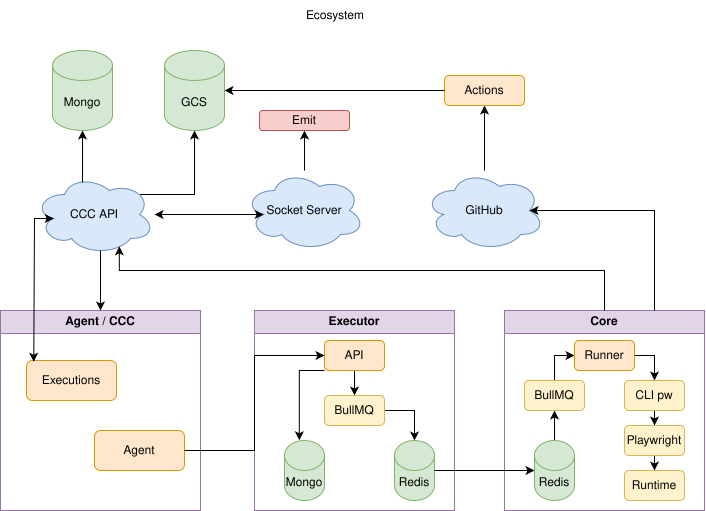

# Executor

Executor es una API Express para orquestar ejecuciones de Playwright usando MongoDB, Redis, BullMQ y Socket.io. Sirve como backend para disparar, monitorear y detener ejecuciones distribuidas de bots o pruebas automatizadas.

## Requisitos

- Node.js 18+
- npm
- Docker y Docker Compose
- MongoDB y Redis (pueden levantarse con Docker)

## Arquitectura

```text
Cliente / Dashboard
  -> Express API
  -> Redis + BullMQ
  -> Workers de ejecución
  -> Playwright / browser automation
```

Referencia general de la arquitectura del ecosistema donde este proyecto pertenece:



- MongoDB guarda el estado y metadata de cada ejecución.
- Redis administra la cola de jobs y eventos en tiempo real.
- Socket.io expone eventos de logs y estado al cliente.
- Los workers lanzan Playwright con permisos restringidos por `ALLOWED_PLAYWRIGHT_PROJECTS`.

## Inicio rápido

### 1) Instalar dependencias

```bash
npm install
```

### 2) Configurar variables de entorno

Copia el ejemplo:

```bash
cp .env.example .env
```

Variables clave:

- `PORT`: puerto de la API en desarrollo (`3000` por defecto)
- `MONGODB_URI`: conexión a MongoDB, por ejemplo `mongodb://127.0.0.1:27017/executor`
- `REDIS_HOST`, `REDIS_PORT`, `REDIS_PASSWORD`, `REDIS_DB`
- `PLAYWRIGHT_PROJECT_ROOT_FOLDER`: ruta absoluta del proyecto Playwright
- `ALLOWED_PLAYWRIGHT_PROJECTS`: proyectos permitidos, por ejemplo `cigna,aetna,shared`
- `WORKER_CONCURRENCY`: concurrencia por worker
- `SOCKET_CORS_ORIGIN`: origen permitido para Socket.io

### 3) Levantar dependencias de base de datos

La forma más simple en local es usar Docker para MongoDB y Redis:

```bash
docker compose up -d mongo redis
```

Esto levanta:

- MongoDB en `localhost:27018`
- Redis en `localhost:6380`

### 4) Ejecutar la API en desarrollo

```bash
npm run dev
```

La API queda disponible en:

- http://localhost:3000
- Swagger: http://localhost:3000/docs

## Ejecutar con Docker

Este repo incluye `docker-compose.yml` para levantar la API junto con MongoDB y Redis en un entorno más cercano a producción.

```bash
docker compose up -d --build
```

Servicios expuestos por defecto:

- API: `http://localhost:3018`
- MongoDB: `localhost:27018`
- Redis: `localhost:6380`

Para detenerlos:

```bash
docker compose down
```

## Scripts disponibles

```bash
npm run dev      # desarrollo con nodemon + ts-node
npm run build    # compila TypeScript
npm start        # ejecuta la build compilada
npm test         # compila y corre los tests
```

## Endpoints principales

La API expone operaciones para gestionar ejecuciones.

- `POST /executions`
- `GET /executions`
- `GET /executions/:id`
- `POST /executions/:id/stop`

Ejemplo:

```bash
curl -X POST http://localhost:3000/executions \
  -H 'Content-Type: application/json' \
  -d '{"project":"cigna","workers":3,"retries":2}'
```

## Realtime y logs

La API escucha eventos de Redis y los reenvía por Socket.io.

```js
socket.emit('execution:join', { executionId });
socket.on('execution:logs:history', ({ content }) => console.log(content));
socket.on('logs', (event) => console.log(event.message));
socket.on('status', (event) => console.log(event.status));
```

Los eventos principales quedan en salas por ejecución y se usan para mostrar logs y cambios de estado en tiempo real.

## Producción

```bash
npm run build
npm start
```

También puedes usar PM2 con el archivo `ecosystem.config.js`:

```bash
pm2 start ecosystem.config.js
```

## Troubleshooting

- Si MongoDB o Redis no arrancan, revisa si los puertos `27018` y `6380` están libres.
- Si la API falla al iniciar, confirma que `MONGODB_URI` y `REDIS_HOST` apuntan a los servicios correctos.
- Si `Playwright` no ejecuta proyectos, verifica `PLAYWRIGHT_PROJECT_ROOT_FOLDER` y `ALLOWED_PLAYWRIGHT_PROJECTS`.
- Si necesitas ver la documentación de la API, usa la ruta `/docs`.

## Despliegue básico

El repo incluye un script de despliegue simple en `scripts/deploy.sh`:

```bash
git pull --ff-only
npm ci
npm run build
pm2 reload ecosystem.config.js --update-env
```

